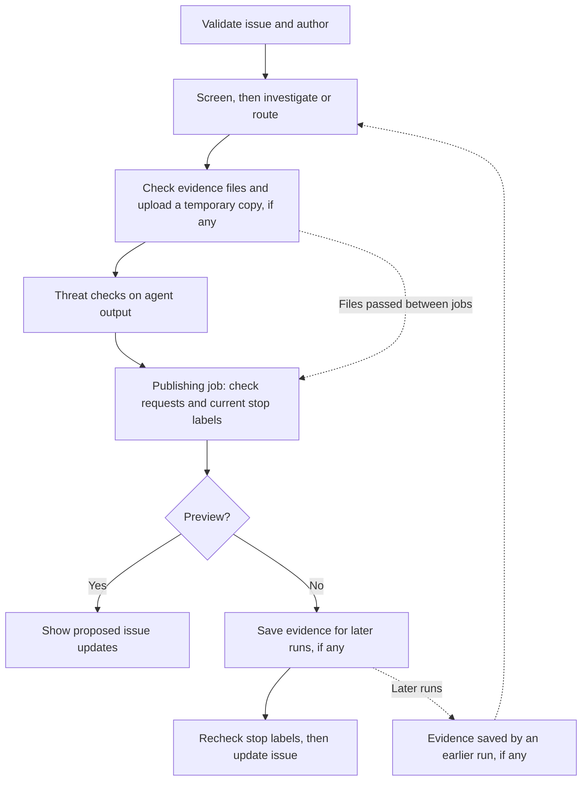

# Issue routing

This guide explains how to run and maintain the issue-routing workflow defined
in `.github/workflows/issue-routing.md`. Its generated Actions file is
`.github/workflows/issue-routing.lock.yml`.

The workflow screens issue reports, tries to reproduce Bugs, and routes them
to a package owner. It does not triage: it does not decide priority, support
scope, or whether action will be taken, and it never removes the `triage` label.
Routing or reproducing a report is not maintainer acceptance; maintainers make
those decisions and remove `triage` themselves.

## When it runs

- **New issues and type changes** (`issues: opened, typed`).
- **Reporter replies**: when the person who opened the issue comments on an issue
  labelled `requested-info`. Other comments, and comments on pull requests, are
  ignored before any work starts, although each one still shows up as a skipped
  run on the Actions page.
- **Manually** from the Actions page (see below).

Runs wait in one shared queue, one at a time. Before an automatic run starts
work, the preparation job looks at earlier runs of this workflow for the same
issue. A run counts as having routed the issue only if it really published
(previews and runs stopped by labels or checks do not count). Then:

- A new issue or type change is skipped if the issue was already routed.
- A reporter reply is skipped if a routed run started after the reply was
  posted (that run already saw it), or if the issue has already had 3 routed
  reply re-runs. The cap stops a reporter from triggering runs without end.

Manual runs always go ahead. On a reply re-run the agent focuses on the new
information, reuses earlier evidence, and does not repeat earlier comments.

## What it does

A small preparation job fetches the selected issue and rejects pull requests or
invalid numbers. Automatic runs accept native Bug/Feature types
and skip authors in `DEVELOPER_TEAM`. This checks the issue author, not the
person or App that triggered the event. Manual runs bypass the team/type check.
The App token helper is used only in preparation, with read access. The
earlier-run lookup uses the normal workflow token with read access to Actions.

The labels `spam` and `suspected-spam` block routing.
`needs-maintainer-triage` also stops it unless a maintainer has reviewed the
report and added `safe-to-triage`. Manual dispatch alone does not bypass these
labels. These rules are checked before investigation, again before saving evidence, and
again immediately before issue updates. A label added during investigation
therefore stops the updates. The check cannot undo an update already in
progress, and updates are not all-or-nothing.
There is no label-triggered entry point.

The agent first checks whether the report is relevant or contains suspicious
instructions. Suspected spam gets only `needs-maintainer-triage`, without a
public accusation or further investigation. This check uses the model, so
screening itself consumes model credits.
Incomplete reports and new authors are not, by themselves, suspicious.

Features receive package ownership/labels without reproduction. Bugs and other
manually selected reports can get local Python/.NET tests or direct verification
of a documentation defect. There are no live model-service credentials.
Failed setup, unavailable services, and blocked requests are inconclusive, not
reproduction or evidence of a fix. For these, the workflow posts a short comment
explaining why it was inconclusive and what the source evidence suggests. The agent cannot implement fixes or create
branches or pull requests.

Ownership rules are in `issue-routing-owners.yaml`, including for likely-fixed
reports. There is no separate likely-fixed assignee. Review current package paths
when editing it, and keep the allowed labels/users in the workflow consistent.
The prompt applies path/confidence rules; built-in outputs enforce the allowed
users and labels, not each path-to-owner pairing.

Issue writes use separate, limited publishing steps. Every write is tied to
the validated issue number, including manual dispatch. The agent has read-only
GitHub access. Detection failures block publishing. Routing does not set or change
issue priority; maintainers choose it using the reported evidence. A trusted check
rejects empty, missing, or non-Feature issue-type requests before any issue
update; routing cannot clear the current type.

Reports keep the reproduction result separate from the support boundary
(Direct support, Best effort, Unsupported, Extension point, or Unclear) and cite
the source that sets it. Unclear scope is left to a maintainer. Reports also
record the affected and reported versions and, when verified, a known-good
version, the introducing or fixing change, and whether a fix is released.

## Flow at a glance



Evidence is optional: runs without evidence files can still propose issue
updates. Failed checks or stop labels block the updates. The agent and the
publishing job run separately, so the temporary copy passes the files between
them. Like all uploads, it is visible to anyone who can see the repository's
Actions runs, and is normally kept for one day. Preview may create the temporary
copy, but does not update the issue or save evidence for later runs.

## Running and testing

From the Actions page, run **Issue Routing** with an issue number and leave
`preview` selected. Preview still runs code and consumes model credits, but
previews the proposed issue updates instead of applying them. Uploaded files
and run logs are still public in a public repository.

To check changes to the workflow, use an authorized test issue/repository to:

1. Preview a Feature, a local Python failure, a local .NET failure, a passing test,
   a documentation error, missing information, an unavailable service, failed
   restore, and a suspicious report. Check actual test files/output, not just
   the agent's claim. Features and suspicious reports must not run project tests.
2. Verify manual deny/hold/allow labels, external authors, team authors, and
   manual reruns. Check an initially untyped issue that `label-issues.yml` later
   assigns Bug/Feature using the App token.
3. On an authorized disposable issue, deselect `preview` and check label changes
   (with `triage` kept), owner assignment without removing existing assignees, native Feature type,
   unchanged priority, comments, and saved evidence.
4. Check that the published comment is a short explanation linking the run,
   without reproduction JSON. Parse `reproduction.json` from a confirmed
   reproduction's saved evidence. Compare its issue, commit, commands, observed
   result, test paths, and `artifact_name` with the run.
   Repeat a run and check that it does not overwrite human work. Publishing is
   not an all-or-nothing transaction: a failed step may leave earlier writes.
5. After saving evidence for a confirmed reproduction, run that issue again in
   preview. Check the downloaded files and `source.json` against the earlier
   run. Run a different issue and confirm it never receives the first issue's
   evidence. Check that missing or expired evidence allows normal investigation
   and that downloaded files are not automatically executed.
   Keep a useful earlier file in a second run's saved evidence, then check a
   third run receives it with its original run/commit information, including
   when the second run did not confirm a new reproduction.

For testing in another repository, deliberately adjust the GitHub tool's
`allowed-repos` and configure the required environment/authentication there.
Do not grant automatic issue reports access to a private testing repository.
Deploying a test workflow requires an authorized commit/push; local compilation
does not deploy it or prove model judgment, organization access, or SDK behavior.

Keep `roles: all`: external reporters and App-generated type events must reach
the preparation job. Restricting event actors to maintainer roles is not a
check of the author's team.

The earlier-run check relies on the publishing step named "Find this run's
checked evidence". If you rename it, update `ROUTED_STEP` in
`scripts/issue-routing-history.js`; a test checks the two match. GitHub returns
at most 1,000 runs per search, so if more runs have happened since the issue was
opened, the check stops with an error instead of guessing. Run the workflow
manually for that issue.

To pause automatic routing, disable the workflow from the Actions page, or
remove the `issues` and `issue_comment` triggers and recompile the lock file in
a reviewed change. Do not automatically reverse published issue or human edits.

## Records and limits

Confirmed failures include a short evidence comment linking the Actions run.
Reproduction JSON is saved as `reproduction.json` in the evidence files, not
posted in the comment. The workflow prompt defines version 1: repository/issue,
tested commit, run URL, confirmed result/kind, steps, actual commands,
expected/observed behavior, source/test paths, upload name (`artifact_name`), and
documentation location when applicable. Runtime records need actual failing
commands and captured tests; documentation records can leave those fields empty.

Only confirmed runtime failures or directly verified documentation defects
receive a new record. Never use a reporter's claim as an observed result.
Test paths distinguish saved evidence files from checked-in tests. These records
document findings; they do not authorize other automation to skip verification.

### Evidence files

The agent saves tests, commands, output, and a current `report.md` under
`/tmp/gh-aw/agent/routing/issue-routing-issue-N/`, where `N` is the issue number.
Features and suspected spam save nothing. Missing evidence is normal.

Trusted code checks the folder before anything leaves the agent job:
at most 10 MiB of file contents and 1,000 files, including kept history.
Links, special files, and names containing backslashes or control characters
are rejected. At most 2,000 files/folders together and 1 MiB of path names are
allowed, so empty folders or very long paths cannot get around the size limits.
The checker is copied out of the agent's reach before the agent starts.

The agent cannot upload files itself. After the checks, its job uploads a
temporary copy named `issue-routing-transfer`, kept for one day. A failed check
stops the upload and the issue updates.

### Saving evidence for later runs

After investigation and threat checks succeed, the publishing job downloads the
temporary copy from the same run only. It allows up to 14 MiB compressed,
checks the files again, and checks current stop labels. It then saves the files
as `issue-routing-issue-N`. This happens before issue updates, so a review-hold
label requested by this run does not block its own evidence. Labels are checked
again immediately before the issue updates. Preview runs do not save evidence
for later runs.

Saved evidence is kept for seven days by default. The repository variable
`GH_AW_DEFAULT_ARTIFACT_RETENTION_DAYS` can change this, and repository
retention rules still apply. Uploaded files and logs follow the repository's
visibility. Each run's uploads are separate, so reruns never overwrite earlier
evidence.

### Using evidence from an earlier run

For Bugs and other non-Feature reports, setup downloads the latest saved
evidence from an earlier successful run of this workflow on the default branch.
It checks the repository, workflow path, issue-specific run name, and source
run commit, rather than trusting an upload name or a link in an issue comment.
Files go under `/tmp/gh-aw/agent/previous-routing/files/`; the adjacent
`source.json` records which issue, run, and workflow commit they came from.
The tested checkout revision must be read from the earlier report; it can differ
from the workflow run's commit. Features skip this download.

If no eligible evidence remains, investigation starts without it. API,
authentication, or download errors fail the run rather than pretending nothing
was saved. Uploads over the 11 MiB download limit produce a warning and are
skipped in favor of older eligible evidence, or none. Expired or deleted
evidence cannot be downloaded. Runs from before the issue-specific naming and
source-run checks were added are not used.

The agent job has Actions read permission for these setup steps, but no Actions
write permission or Actions toolset. Setup does not execute downloaded files.
After the spam check, the agent can inspect them as untrusted earlier evidence
and adapt relevant tests to the current checkout itself. Earlier results never
count as a reproduction in the current run.

Only the latest saved evidence is downloaded, so each run must copy forward any
reviewed earlier files that later runs should still see. Keep them under
`history/<original-run-id>/` with their original report/record, tested commit,
run URL, commands, and results. Keep existing history paths instead of nesting
whole earlier evidence folders. Do not blindly copy everything or overwrite
product code. Copying keeps files available longer; it does not make old results
current.

Save evidence when there is useful new evidence or reviewed evidence to keep,
even if this run is inconclusive, passing, or likely-fixed. Include a current
report separating this run's finding from earlier results and explaining what
was kept or left out. Only a newly confirmed reproduction gets a top-level
`reproduction.json`; older records stay in `history/`. No extra issue comment
is needed just to keep files. A run that saves nothing leaves the earlier
evidence as the latest, until it expires.

Reruns may add one useful new comment rather than editing an earlier comment.
No labels are removed, including `triage`. No automatic closure occurs.

Runs queue across the whole workflow. This avoids races in daily credit
accounting, at the cost of parallelism.
The generated runtime uses the standard `GH_AW_DEFAULT_MAX_AI_CREDITS`,
`GH_AW_DEFAULT_MAX_DAILY_AI_CREDITS`, and detection-credit settings; configure
them for the repository. The agent timeout is 60 minutes.

## Maintaining and checking the workflow

Use the reviewed compiler/runtime version, currently `github/gh-aw` v1.0.1:

```bash
gh extension install github/gh-aw --pin v1.0.1
gh aw compile issue-routing --strict --validate --actionlint --shellcheck --no-check-update
node --test .github/tests/issue-routing-prepare.test.js .github/tests/issue-routing-history.test.js .github/tests/issue-routing-artifacts.test.js .github/tests/issue-routing-evidence.test.js .github/tests/issue-routing-publish.test.js .github/tests/test_check_team_membership.js .github/tests/issue-routing-workflow.test.js .github/tests/test_issue_plan_workflow.js .github/tests/test_set_missing_issue_type.js
```

CI also loads the exact pinned publisher and runs
`issue-routing-publisher.test.js` with mocked GitHub calls. Those checks exercise
manual targeting, comment limits, preview, short comments without reproduction
JSON, the guarded Feature-only type update, and current/historical JSON surviving
both evidence checks. To run them
locally, set `GH_AW_TEST_RUNTIME` to the directory of scripts
from that pinned setup action and include that test file. Without this setting
the suite explicitly skips; it must not skip in CI. These tests are not a
substitute for the live workflow checks.

If the extension is already installed at another version, check the installed
version and upgrade deliberately rather than silently recompiling with it.
Do not hand-edit the lock file or recompile unrelated workflows.

The first compilation may flag the existing team/App secret references for
review. All belong only to the separate `prepare` job; it checks out trusted
repository scripts and exports metadata, never credentials. The runtime
action is SHA-pinned in the generated file and `.github/aw/actions-lock.json`.

The optional `--zizmor` scan currently flags generated secret references outside
environments and missing permission comments. These are not a clean scanner
pass: review them when upgrading the compiler. Do not hand-edit generated files
or silently disable the checks. The optional `--poutine` compiler integration
also scans unrelated repository workflows and may create a `.poutine.yml`;
review its scope and generated files before retaining any changes.
Use the compiler's Actions validation for the lock file: standalone actionlint
1.7.12 does not yet recognize `copilot-requests`, queued concurrency, or
`job.workflow_ref`. The compiler handles these platform extensions.

## Future live-service tests

The workflow runs only local tests. The agent engine's inference
login does not authenticate application OpenAI/Azure/Anthropic SDK calls.

The official [Azure authentication helper][azure-auth] can give generated tests
a short-lived Azure CLI session, including through `DefaultAzureCredential`.
Those tests can use that identity's permissions: short-lived login does **not**
hide credentials or privileges from arbitrary test code.

A future approved mode should use dedicated test resources/identity, only
model-call permissions, no production data, tight service quotas, exact network
destinations, and maintainer approval. Match Azure trust settings to the actual
repository and environment. Do not reuse the broad integration identity.
Test-scoped provider keys are another option, but remain readable by test code.

For stronger separation, a small external service can hold credentials and
accept only fixed, bounded model requests from uncredentialed tests. It must
enforce models, endpoints, request/token/call limits and safe responses. This
needs separate implementation and SDK compatibility tests; it must not become
a credentialed arbitrary-code runner.

Network destination lists do not limit spending or operations on an allowed
service. Output masking and scanning are extra checks, not secret containment.

[azure-auth]: https://github.github.com/gh-aw/guides/mcps/#azure-shared-imports-oidc-azure-devops-azure-mcp
