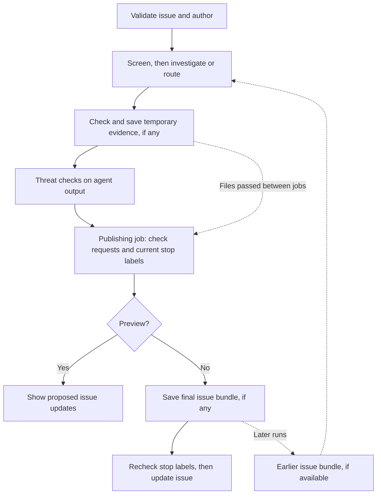

# Issue routing

This guide explains how to run and maintain the issue-routing workflow defined
in `.github/workflows/issue-routing.md`. Its generated Actions file is
`.github/workflows/issue-routing.lock.yml`.

The workflow screens issue reports, tries to reproduce Bugs, and routes them
to a package owner. It does not triage: it does not decide priority, support
scope, or whether action will be taken, and it never removes the `triage` label.
Routing or reproducing a report is not maintainer acceptance; maintainers make
those decisions and remove `triage` themselves.

The workflow is currently **manual-only**. Automatic issue triggers are not
enabled.

## What it does

A small preparation job fetches the selected issue and rejects pull requests or
invalid numbers. Automatic runs, once enabled, accept native Bug/Feature types
and skip authors in `DEVELOPER_TEAM`. This checks the issue author, not the
person or App that triggered the event. Manual runs bypass the team/type check.
The App token helper is used only in preparation, with read access.

The labels `spam` and `suspected-spam` block routing.
`needs-maintainer-triage` also stops it unless a maintainer has reviewed the
report and added `safe-to-triage`. Manual dispatch alone does not bypass these
labels. These rules are checked before investigation and checked again before
publishing evidence and immediately before issue updates. A label added during
investigation therefore stops publication. The check cannot undo an API write
already in progress; publishing is not an all-or-nothing transaction.
There is no label-triggered entry point.

The agent first checks whether the report is relevant or contains suspicious
instructions. Suspected spam gets only `needs-maintainer-triage`, without a
public accusation or further investigation. This check uses the model, so
screening itself consumes model credits.
Incomplete reports and new authors are not, by themselves, suspicious.

Features receive package ownership/labels without reproduction. Bugs and other
manually selected reports can get local Python/.NET tests or direct verification
of a documentation defect. There are no live model-service credentials.
Failed setup, unavailable services, and blocked requests are inconclusive, not
reproduction or evidence of a fix. The agent cannot implement fixes or create
branches or pull requests.

Ownership rules are in `issue-routing-owners.yaml`, including for likely-fixed
reports. There is no separate likely-fixed assignee. Review current package paths
when editing it, and keep the allowed labels/users in the workflow consistent.
The prompt applies path/confidence rules; built-in outputs enforce the allowed
users and labels, not each path-to-owner pairing.

Issue writes use separate, limited publishing steps. Every write is tied to
the validated issue number, including manual dispatch. The agent has read-only
GitHub access. Detection failures block publishing. Routing does not set or change
issue priority; maintainers choose it using the reported evidence. A trusted check
rejects empty, missing, or non-Feature issue-type requests before any issue
update; routing cannot clear the current type.

Reports keep the reproduction result separate from the support boundary
(Direct support, Best effort, Unsupported, Extension point, or Unclear) and cite
the source that sets it. Unclear scope is left to a maintainer. Reports also
record the affected and reported versions and, when verified, a known-good
version, the introducing or fixing change, and whether a fix is released.

## Flow at a glance



Evidence is optional: runs without a bundle can still propose issue updates.
Failed checks or blocking labels stop publication. The temporary bundle carries
files between separate jobs; it is still an Actions artifact with the repository's
visibility, normally retained for one day. Preview may create that temporary
transfer, but does not publish issue updates or save a final reusable bundle.

## Running and testing

From the Actions page, run **Issue Routing** with an issue number and leave
`preview` selected. Preview still runs code and consumes model credits, but
previews the proposed issue updates instead of applying them. Artifacts and
Actions records are still public in a public repository.

Only one workflow should automatically handle a given issue event. Before
enabling automatic routing, use an authorized test issue/repository to:

1. Preview a Feature, a local Python failure, a local .NET failure, a passing test,
   a documentation error, missing information, an unavailable service, failed
   restore, and a suspicious report. Check actual test files/output, not just
   the agent's claim. Features and suspicious reports must not run project tests.
2. Verify manual deny/hold/allow labels, external authors, team authors, and
   manual reruns. Check an initially untyped issue that `label-issues.yml` later
   assigns Bug/Feature using the App token.
3. On an authorized disposable issue, deselect `preview` and check label changes
   (with `triage` kept), owner assignment without removing existing assignees, native Feature type,
   unchanged priority, comments, and reproduction artifacts.
4. Check that the published comment is a short explanation linking the run,
   without reproduction JSON. Parse `reproduction.json` from a confirmed
   reproduction's artifact. Compare its issue, commit, commands, observed
   result, test paths, and artifact name with the run.
   Repeat a run and check that it does not overwrite human work. Publishing is
   not an all-or-nothing transaction: a failed step may leave earlier writes.
5. After publishing a confirmed reproduction bundle, run that issue again in
   preview. Check the downloaded files and `source.json` against the earlier
   run. Run a different issue and confirm it never receives the first issue's
   bundle. Check that missing/expired bundles allow normal investigation and
   that downloaded files are not automatically executed.
   Retain a useful earlier file in a second published bundle, then check a third
   run receives it with its original run/commit information, including when the
   second run did not confirm a new reproduction.

For testing in another repository, deliberately adjust the GitHub tool's
`allowed-repos` and configure the required environment/authentication there.
Do not grant automatic issue reports access to a private testing repository.
Deploying a test workflow requires an authorized commit/push; local compilation
does not deploy it or prove model judgment, organization access, or SDK behavior.

After those checks, add the following under `on` in `issue-routing.md` and remove
the manual-only comment in a reviewed change:

```yaml
issues:
  types: [opened, typed]
```

Recompile the lock file and update the manual-only assertion in
`issue-routing-workflow.test.js` to require this trigger.
Keep `roles: all`: external reporters and App-generated type events must reach
the preparation job. Restricting event actors to maintainer roles is not a
check of the author's team.

To pause automatic routing, remove the `issues` trigger and recompile the lock
file in a reviewed change. Do not automatically reverse published issue or
human edits.

## Records and limits

Confirmed failures include a short evidence comment linking the Actions run.
Reproduction JSON is saved as `reproduction.json` in the artifact, not posted
in the comment. The workflow prompt defines version 1: repository/issue, tested
commit, run URL, confirmed result/kind, steps, actual commands, expected/observed
behavior, source/test paths, artifact name, and documentation location when
applicable. Runtime records need actual failing commands and captured tests;
documentation records can leave those fields empty.

Only confirmed runtime failures or directly verified documentation defects
receive a new record. Never use a reporter's claim as an observed result.
Test paths distinguish artifact files from checked-in tests. These records
document findings; they do not authorize other automation to skip verification.

Each issue uses the artifact name `issue-routing-issue-N`, where `N` is its
issue number. GitHub keeps artifacts separate by repository and workflow run,
so reruns can save new bundles without overwriting earlier ones.

For Bugs and other non-Feature reports, setup downloads the latest retained
bundle from an earlier successful run of this workflow on the default branch.
It checks the repository, workflow path, issue-specific run name, and source
run commit rather than trusting an artifact name or a link in an issue comment.
Files go under `/tmp/gh-aw/agent/previous-routing/files/`; the adjacent
`source.json` records which issue, run, and workflow commit they came from.
The tested checkout revision must be read from the earlier report; it can
differ from the workflow run's commit. Features skip
this download. If no eligible bundle remains, investigation starts without one.
API/authentication/download errors fail visibly rather than pretending no
bundle exists. Archives exceeding the 11 MiB download budget produce a warning
and are skipped in favor of an older eligible bundle, or no history.

The agent job now has Actions read permission for these setup steps, but no
Actions write permission or Actions toolset. Downloaded files are not executed
by setup. After the spam check, the agent can inspect them as untrusted earlier
evidence and independently adapt relevant tests to the current checkout.
Earlier results never count as a reproduction in the current run.

Because only the latest bundle is downloaded, each new bundle must carry forward
any reviewed earlier files that should remain available to later runs. Keep them
under `history/<original-run-id>/` with their original report/record, tested
commit, run URL, commands, and results. Preserve existing history paths instead
of nesting whole bundles. Do not blindly copy everything or overwrite product
code. Copying keeps files available longer; it does not make old results current.

Upload a new bundle when there is useful new evidence or reviewed evidence to
retain, even if this run is inconclusive, passing, or likely-fixed. Include a
current report separating this run's finding from earlier results and explaining
what was kept or omitted. Only a newly confirmed reproduction gets a root
`reproduction.json`; older records remain in `history/`. No extra issue comment
is needed merely to retain files. Features and suspected spam do not upload
bundles. A run that uploads nothing leaves the previous eligible bundle as the
latest, until it expires.

Generated tests, commands, and output go under
`/tmp/gh-aw/agent/routing/issue-routing-issue-N/`, including a current
`report.md`. Trusted code checks the folder before transferring anything:
at most 10 MiB of file contents and 1,000 files, including retained history.
Links, special files, and names containing backslashes or control characters
are rejected. At most 2,000 files/folders together
and 1 MiB of path names are allowed, preventing empty folders or very long
paths from escaping the storage bounds.

The agent has no artifact-upload tool. Its job copies checked files into a
separate folder outside the agent's writable paths and uploads only that copy
as `issue-routing-transfer`, with a one-day default retention. The checker
itself is preserved outside writable paths before the agent starts. Missing
evidence is normal; failed checks stop the transfer and publication visibly.

After successful investigation and threat checks, the publishing job finds
that transfer only in the current run. It allows up to 14 MiB compressed for
file/path metadata, checks the extracted files again, and checks current stop
labels before publishing one final issue-specific bundle. This happens before
issue updates so a review-hold label requested by this run does not block its
own evidence. Labels are checked again immediately before the issue updates.
The final bundle's default retention is seven days. The repository variable
`GH_AW_DEFAULT_ARTIFACT_RETENTION_DAYS` can override artifact retention, and
repository retention rules still apply. Standard workflow artifacts have their
own platform defaults. Logs and artifacts follow the destination repository's
visibility and retention rules.
Expired or deleted bundles cannot be downloaded. Runs from before the
issue-specific naming and source-run checks were added are not selected.
Preview can download earlier bundles and creates only the bounded temporary
transfer, not a new reusable issue-specific bundle.

Reruns may add one useful new comment rather than editing an earlier comment.
No labels are removed, including `triage`. No automatic closure occurs.

Runs queue across the whole workflow. This avoids races in daily credit
accounting, at the cost of parallelism.
The generated runtime uses the standard `GH_AW_DEFAULT_MAX_AI_CREDITS`,
`GH_AW_DEFAULT_MAX_DAILY_AI_CREDITS`, and detection-credit settings; configure
them for the repository. The agent timeout is 60 minutes.

## Maintaining and checking the workflow

Use the reviewed compiler/runtime version, currently `github/gh-aw` v1.0.1:

```bash
gh extension install github/gh-aw --pin v1.0.1
gh aw compile issue-routing --strict --validate --actionlint --shellcheck --no-check-update
node --test .github/tests/issue-routing-prepare.test.js .github/tests/issue-routing-artifacts.test.js .github/tests/issue-routing-bundle.test.js .github/tests/issue-routing-publish.test.js .github/tests/test_check_team_membership.js .github/tests/issue-routing-workflow.test.js .github/tests/test_issue_plan_workflow.js .github/tests/test_set_missing_issue_type.js
```

CI also loads the exact pinned publisher and runs
`issue-routing-publisher.test.js` with mocked GitHub calls. Those checks exercise
manual targeting, comment limits, preview, short comments without reproduction
JSON, the guarded Feature-only type update, and current/historical JSON surviving
both evidence checks. To run them
locally, set `GH_AW_TEST_RUNTIME` to the directory of scripts
from that pinned setup action and include that test file. Without this setting
the suite explicitly skips; it must not skip in CI. These tests are not a
substitute for the live workflow checks.

If the extension is already installed at another version, check the installed
version and upgrade deliberately rather than silently recompiling with it.
Do not hand-edit the lock file or recompile unrelated workflows.

The first compilation may flag the existing team/App secret references for
review. All belong only to the separate `prepare` job; it checks out trusted
repository scripts and exports metadata, never credentials. The runtime
action is SHA-pinned in the generated file and `.github/aw/actions-lock.json`.

The optional `--zizmor` scan currently flags generated secret references outside
environments and missing permission comments. These are not a clean scanner
pass: review them when upgrading the compiler. Do not hand-edit generated files
or silently disable the checks. The optional `--poutine` compiler integration
also scans unrelated repository workflows and may create a `.poutine.yml`;
review its scope and generated files before retaining any changes.
Use the compiler's Actions validation for the lock file: standalone actionlint
1.7.12 does not yet recognize `copilot-requests`, queued concurrency, or
`job.workflow_ref`. The compiler handles these platform extensions.

## Future live-service tests

The workflow runs only local tests. The agent engine's inference
login does not authenticate application OpenAI/Azure/Anthropic SDK calls.

The official [Azure authentication helper][azure-auth] can give generated tests
a short-lived Azure CLI session, including through `DefaultAzureCredential`.
Those tests can use that identity's permissions: short-lived login does **not**
hide credentials or privileges from arbitrary test code.

A future approved mode should use dedicated test resources/identity, only
model-call permissions, no production data, tight service quotas, exact network
destinations, and maintainer approval. Match Azure trust settings to the actual
repository and environment. Do not reuse the broad integration identity.
Test-scoped provider keys are another option, but remain readable by test code.

For stronger separation, a small external service can hold credentials and
accept only fixed, bounded model requests from uncredentialed tests. It must
enforce models, endpoints, request/token/call limits and safe responses. This
needs separate implementation and SDK compatibility tests; it must not become
a credentialed arbitrary-code runner.

Network destination lists do not limit spending or operations on an allowed
service. Output masking and scanning are extra checks, not secret containment.

[azure-auth]: https://github.github.com/gh-aw/guides/mcps/#azure-shared-imports-oidc-azure-devops-azure-mcp
